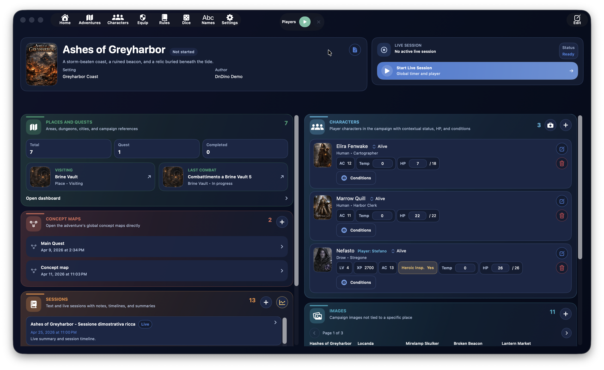
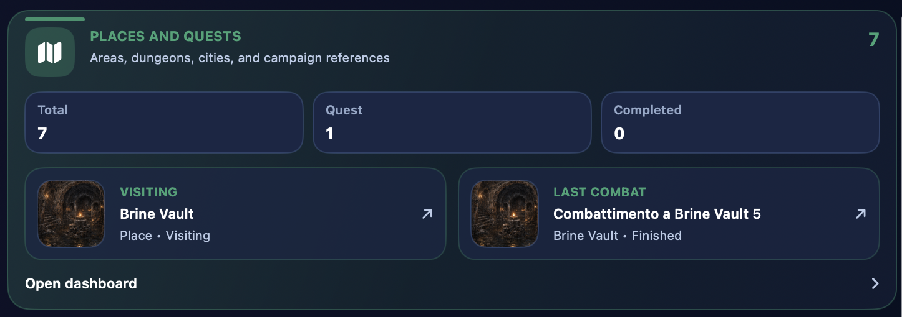
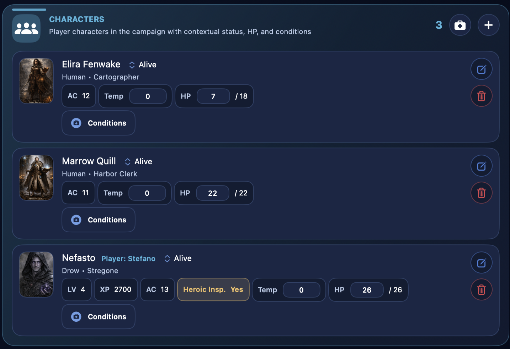
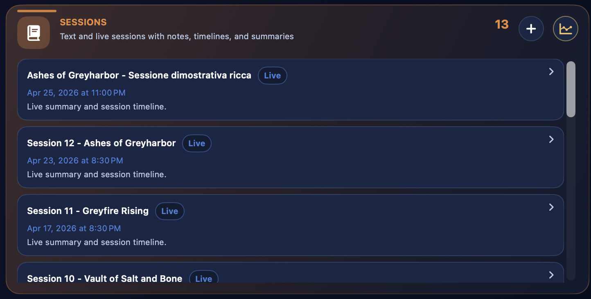
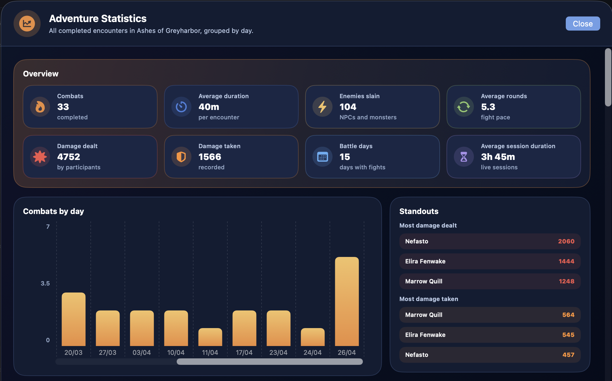
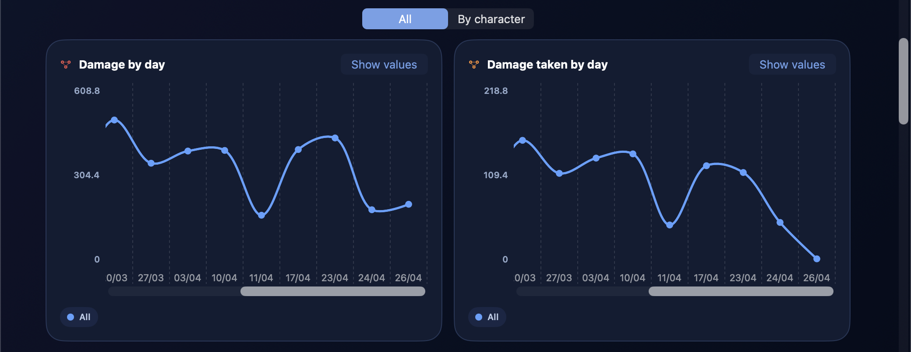
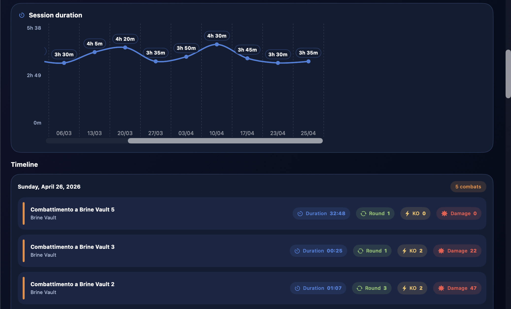
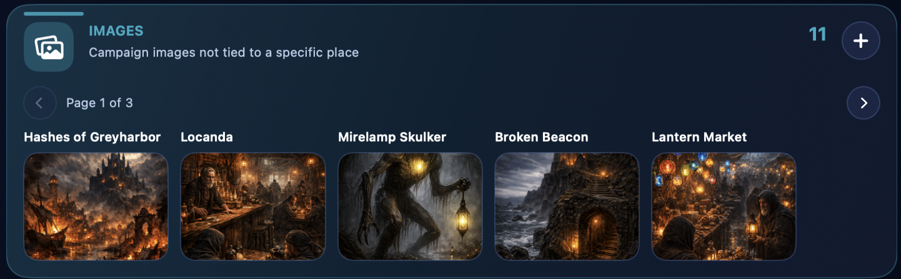
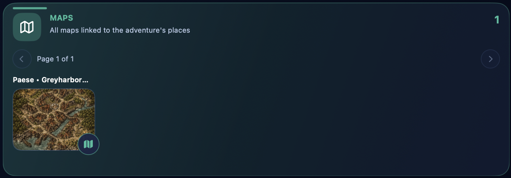
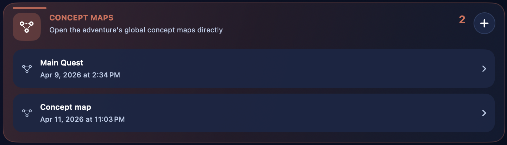

# Aventura

{ .img-hero }

La sección **Aventura** es el centro organizativo de una campaña en DnDino. Aquí nace la estructura principal de tu trabajo: el título de la campaña, su identidad visual, los personajes vinculados, las sesiones, los lugares, las imágenes compartidas, los mapas y los accesos rápidos a los combates.

!!! tip
    Piensa en el panel principal de la aventura como el **cuartel general de la campaña**: no es el lugar donde haces todo al detalle, sino el punto desde el que llegas rápidamente a todas las áreas realmente operativas.

Esta página explica el recorrido principal:

- creación de una nueva aventura
- edición y gestión de una aventura existente
- funcionamiento del panel principal de la aventura
- relación entre el panel principal y las subpáginas dedicadas

Las áreas más específicas, como **Lugares**, **Mapas conceptuales**, **Sesión en vivo**, **Personajes**, **Imágenes** y **Mapas**, se explican con más detalle en sus páginas dedicadas.

## Accesos rápidos y personajes vinculados

Toda la fila de una sesión abre su detalle para editar título, notas del DM y, tras terminar, el intervalo. **Volver a la aventura** regresa aquí desde lugares; **Volver al lugar** abre el lugar asociado desde un resumen de combate.

Retirar un personaje del panel no elimina su ficha general. Con confirmaciones activas, DnDino pregunta antes de retirarlo.

Solo el DJ controla la sincronización por dispositivo. Si está autorizada, se reanuda al reconectar Hero. Para vincular, actualizar fichas o usar el chat, consulta [Conectar Hero: guía del DM](hero-sync.md).

## Para qué sirve una aventura

En DnDino una aventura es el contenedor principal de una campaña o de un arco narrativo. Sirve para reunir, dentro de un mismo contexto:

- los personajes vinculados a la campaña
- los lugares y las misiones
- las sesiones de texto y las sesiones en vivo
- las imágenes compartidas
- los mapas asociados a los lugares
- los mapas conceptuales globales
- los combates que nacen en lugares vinculados a la aventura

Por tanto, una aventura no es solo una ficha descriptiva, sino el punto de entrada a toda la parte operativa de la campaña.

## Dónde se crea una aventura

La creación empieza en la **lista de aventuras**.

Desde esa pantalla puedes:

- crear una nueva aventura con el botón `Nueva`
- crear la primera aventura con el gran botón central `Crear una aventura`, si la base de datos aún está vacía
- abrir una aventura existente haciendo clic en su fila
- editar una aventura existente
- clonar una aventura ya creada
- eliminar una aventura

La lista también puede ordenarse por:

- nombre
- fecha de creación
- última modificación

!!! note
    Cuando ordenas por **última modificación**, DnDino no mira solo la ficha de la aventura, sino también la actividad relacionada, como lugares, sesiones, personajes de aventura, mapas conceptuales y combates.

## Creación de una nueva aventura

Cuando abres el formulario de creación, DnDino te muestra la información principal de la campaña.

Los campos principales son:

- `Título`
- `Autor`
- `Ambientación`
- `Descripción breve`
- `Estado`

El campo **Estado** usa un control segmentado y te permite indicar si la aventura está:

- no iniciada
- en curso
- completada

## Descripción ampliada

Debajo de la información principal también encontrarás una sección **Descripción** más amplia.

Esta zona sirve para anotar una presentación más completa de la campaña, por ejemplo:

- el tono de la aventura
- el contexto narrativo
- los objetivos iniciales
- notas generales para el Director de Juego

La descripción larga no se pierde dentro del panel principal: si existe, puede volver a abrirse rápidamente más adelante.

## Portada e imágenes de la aventura

En el formulario puedes asignar una **portada** a la aventura. La portada se utiliza como imagen representativa de la campaña en las pantallas principales.

También puedes añadir imágenes en la sección **Imágenes de aventura**. Estas imágenes:

- permanecen vinculadas a la aventura
- no pertenecen a un lugar concreto
- pueden mostrarse rápidamente a los jugadores o al Director desde el panel principal

Para cada imagen puedes gestionar:

- nombre visible
- visibilidad para `Jugadores`
- visibilidad para `Director`

## Edición de una aventura existente

Cuando abres una aventura existente en edición, el formulario es el mismo que el de creación, pero con una sección adicional: **Restablecer aventura**.

Este restablecimiento no elimina la estructura de la campaña, sino que borra el estado actual de juego. En concreto:

- elimina todos los personajes de aventura vinculados
- borra todas las sesiones guardadas
- devuelve lugares y misiones a su estado inicial
- devuelve PNJ y monstruos a sus PG máximos y sin condiciones
- reinicia los combates preparados sin borrar su estructura

Esta función es útil cuando quieres reutilizar el armazón de una campaña o devolver la aventura a un estado limpio sin reconstruirla desde cero.

## Clonado y eliminación

Desde la lista de aventuras también puedes:

### Clonar una aventura

El clonado crea una copia de la campaña mediante el servicio interno de duplicación. Es útil cuando quieres:

- partir de una estructura parecida
- reutilizar una configuración base
- crear una variante de una campaña existente

### Eliminar una aventura

Cuando eliminas una aventura, DnDino elimina el registro principal y además inicia la limpieza de los recursos vinculados. También actualiza las referencias de los personajes globales para quitar el vínculo con la aventura eliminada.

## Apertura del panel principal de aventura

Al hacer clic en una aventura de la lista entras en su **panel principal**, que es el verdadero centro operativo de la campaña.

El panel principal está organizado como una pantalla con bloques:

- una banda superior con el encabezado de la aventura
- dos columnas inferiores con tarjetas dedicadas a las distintas áreas de la campaña

El orden de los paneles puede personalizarse desde los ajustes de la aplicación.

## Encabezado del panel principal

La parte superior del panel reúne la información esencial de la aventura:

- portada
- título
- estado
- descripción breve
- ambientación
- autor

Si la aventura también tiene una descripción larga, aparece un botón dedicado para abrirla en un popover y leerla sin salir del panel.

Desde aquí también puedes entrar en **Editar** para volver al formulario de la aventura y actualizar sus datos.

## Sesión en vivo

En una página de la aventura, abre **Sesión en vivo** en la **barra inferior**, a la izquierda de Hero. Pulsa **Iniciar** y confirma para empezar una sesión de la aventura actual.

Si hay una sesión abierta, el control sigue disponible fuera de la aventura. No se puede iniciar una segunda sesión a la vez. [Guía de la sesión en directo](live-session.md#live-session-bottom-bar).

## Los paneles del dashboard

Debajo del encabezado, el dashboard muestra los principales paneles de la aventura.

Actualmente son:

- `Lugares y Misiones`
- `Personajes`
- `Sesiones`
- `Imágenes`
- `Mapas`
- `Mapas conceptuales`
- `Estadísticas`
- `Metadatos`

!!! tip
    Desde los ajustes puedes modificar tanto la columna como el orden de los paneles dentro del panel principal de aventura.

### Lugares y Misiones

{ .img-shot }

Este panel es el punto de entrada al dashboard de lugares.

Desde aquí puedes ver rápidamente:

- número total de lugares
- número total de misiones
- número de misiones completadas

Además pueden aparecer accesos rápidos a:

- el último lugar útil
- el último combate útil

Al abrir esta tarjeta entras en la sección que gestiona:

- lugares
- sublugares
- presencias
- imágenes de lugar
- mapas
- mapas interactivos
- combates vinculados a los lugares

Esta parte se describe con más detalle en la página dedicada a **Lugares**.

### Personajes

{ .img-shot }

El panel **Personajes** muestra los personajes vinculados a la campaña.

Aquí puedes:

- ver los personajes de aventura ya vinculados
- añadir otros nuevos
- curarlos rápidamente con `Curar todo`
- abrir su estado contextual de campaña

Esta sección no sustituye la ficha base del personaje: muestra la capa específica de la campaña, con estado, PG y condiciones contextuales.

#### Salud y asistencia de los personajes {#character-health-attendance}

En el panel, **Vivo**, **Inconsciente** y **Muerto** describen la salud y son de solo lectura. **Presente/Ausente** es una selección separada que no cambia los PG ni las condiciones. Al preparar un combate, **Añadir todos** omite a los ausentes, aunque puedes añadirlos de uno en uno. La insignia verde **Live** indica sincronización activa, no solo conexión con Hero.

La diferencia entre:

- ficha base
- personaje de aventura
- personaje de lugar
- participante en combate

se explica con más detalle en la página dedicada a **Personajes**.

### Sesiones

{ .img-shot }

El panel **Sesiones** reúne:

- sesiones de texto
- sesiones en vivo
- notas
- resúmenes
- línea temporal

Desde aquí también puedes crear una nueva sesión de texto. Las sesiones son, por tanto, la memoria narrativa y operativa de la campaña.

Esta área se desarrollará más a fondo en la página dedicada a la **Sesión en vivo** y a la gestión de sesiones.

<!-- guide-coverage: MOD-014 MOD-028 MOD-029 MOD-030 MOD-065 -->

### Estadísticas de Aventura

{ .img-shot }
{ .img-shot }
{ .img-shot }

El panel **Estadísticas** abre una ventana dedicada a leer la evolución de la campaña.

Esta vista reúne los combates completados de la aventura, incluso los concluidos fuera de una sesión en vivo, y los organiza cronológicamente.

Entre los datos principales puedes encontrar:

- número total de combates
- duración media de los encuentros
- duración media de las sesiones
- tiempo medio de turno para héroes y DJ
- enemigos derrotados
- personajes de aventura con más daño infligido
- personajes de aventura con más daño recibido

El historial agrupa combates por **sesión**, con detalle en la misma ventana y retorno a estadísticas. Los combates sin sesión permanecen separados.

Los gráficos muestran daño infligido/recibido por combate y sesión, número de combates por sesión, duración de sesiones y tiempo medio de turno por sesión o combate. Las vistas por sesión usan la **fecha de inicio**: sesiones del mismo día siguen distintas y las que pasan medianoche no se dividen.

Para daño elige **Todos** o **Por personaje** y activa series desde la leyenda. Los colores de cada personaje son coherentes entre gráfico y resumen.

Los valores numéricos pueden mostrarse u ocultarse con el control correspondiente, para elegir entre claridad y detalle. Los gráficos pueden desplazarse horizontalmente y tienen controles de zoom independientes, para ampliar o comprimir una lectura sin afectar a los demás.

!!! note
    Las clasificaciones principales de daño se centran en los personajes de aventura. Los PNJ y monstruos siguen siendo importantes en combate, pero a largo plazo tendrían un peso demasiado variable.

### Imágenes

{ .img-shot }

El panel **Imágenes** reúne las imágenes globales de la aventura, es decir, las que no están ligadas a un lugar concreto.

Desde aquí puedes:

- añadir imágenes
- recorrerlas por páginas
- mostrarlas rápidamente a los jugadores
- mostrarlas rápidamente al Director

Es la zona adecuada para todo el material visual “de campaña” que no pertenece a un lugar concreto.

### Mapas

{ .img-shot }

El panel **Mapas** muestra todos los mapas vinculados a los lugares de la aventura.

Los mapas no se añaden directamente aquí: aparecen en el panel principal cuando ya se han vinculado a un lugar.

Desde esta tarjeta puedes:

- recorrer los mapas de la aventura
- mostrarlos a jugadores o Director
- abrir directamente el mapa interactivo relacionado con el lugar, si existe

Esta parte se desarrolla en las páginas dedicadas a **Mapas** y **Mapas interactivos**.

### Mapas conceptuales

{ .img-shot }

El panel **Mapas conceptuales** reúne los mapas conceptuales globales de la aventura.

Desde aquí puedes:

- ver cuántos mapas conceptuales existen
- abrirlos rápidamente
- crear uno nuevo

Los mapas conceptuales son útiles para conectar ideas, lugares, personajes y relaciones narrativas. Se explican en su página específica.

### Metadatos

Si en los ajustes has activado la visualización de metadatos, también aparece un panel técnico con:

- ID de la aventura
- fecha de creación
- fecha de última modificación

Es una sección útil sobre todo para control, diagnóstico o gestión avanzada.

## Relación con las subpáginas

La página **Aventura** es una visión general. A partir de aquí, las páginas hijas profundizan en cada herramienta operativa concreta.

Las subpáginas de esta guía serán:

- **Lugares y Misiones**
- **Mapas conceptuales**
- **Estadísticas de Aventura**
- **Imágenes**
- **Mapas**
- **Mapas interactivos**
- **Sesión en vivo**
- **Personajes**

En la práctica:

- esta página explica **cómo nace y cómo se estructura** una aventura y cómo está organizado el panel principal de aventura
- las páginas hijas explican **cómo se usa realmente cada sección interna**

## Cuándo usar esta sección

La sección Aventura es el lugar adecuado cuando quieres:

- crear una nueva campaña
- definir la portada, el estado y la descripción de la aventura
- retomar el trabajo de una campaña existente
- entrar en el panel principal
- iniciar una sesión en vivo
- llegar rápidamente a los lugares, personajes, sesiones, imágenes y mapas de la campaña
- consultar estadísticas y gráficos de combates completados
## Novedades de la versión 1.4

La Dashboard de aventura ahora incluye una gestión centralizada de imágenes.

Desde ese gestor puedes revisar imágenes enlazadas a la aventura y a sus lugares sin duplicados, editar su nombre mostrado, enseñarlas a jugadores o al DM, compartirlas con macOS, ver dónde se usan y activar o desactivar las marcas `Mapa interactivo` y `Mapa sombra`.

El panel de mapas también permite filtrar entre todos los mapas, mapas interactivos y Mapas sombra.
