# Combate

A secção **Combate** é o gestor operacional dos encontros em DnDino. Foi pensada para ser rápida, compacta e legível quando a mesa está no momento mais intenso da sessão.

O combate nasce sempre a partir de um **local** e pode incluir os heróis da aventura, presenças locais, NPCs e monstros ligados à cena.

Esta página explica:

- preparação do pré-combate
- introdução e ordenação da iniciativa
- ecrã principal de combate
- controlos do turno
- ataques, dano, cura, condições e salvaguardas
- ligações internas em ataques e capacidades
- resumo lateral, últimos eventos e anulação
- Janela dos Jogadores
- resumo final e estatísticas

## Renomear por iniciativa

**Renomear por iniciativa**, junto de **Ordenar**, numera por iniciativa decrescente PNJ e monstros da mesma ficha base. Reconhece o nome genérico sem número e os sufixos numéricos habituais: `Goblin`, `Goblin 2`, `Goblin (3)`. Heróis e nomes realmente diferentes, como `Capitão Goblin`, ficam excluídos.

O goblin com iniciativa 20 torna-se `Goblin 1`, o de 10 torna-se `Goblin 2`. Zero e valores negativos funcionam; os empates usam Destreza e a ordem atual. Só os nomes do combate mudam, não identidades, PV, estatísticas, fichas base ou presenças. **Ordenar** reorganiza separadamente o acompanhamento.

## Preparação, valores locais e resumo

- **Visualização**, no painel **Visibilidade para jogadores**, está ativa por predefinição para cada participante e controla apenas a apresentação inicial. Desativá-la não remove o participante do combate. A ajuda do ponto de interrogação segue a definição global dos botões de ajuda.
- As presenças locais usam a sua própria **CA e PV máximos**, sem modificar a base ou outras cópias. A CA de participantes acrescentados diretamente da lista geral continua específica do combate.
- Os atributos apresentam linhas alinhadas de valores, **MOD** e **salvaguardas**. As salvaguardas também são editáveis no editor rápido; o lançamento usa o valor explícito, senão o modificador do atributo, ou zero se faltarem ambos.
- Os nomes de PNJ e monstros são editáveis; passa o rato sobre nomes longos para os ler em deslocamento. A pesquisa ignora maiúsculas/minúsculas e regressa ao topo após filtrar.
- Ocultar nomes inimigos também os oculta nas animações de dano, como atacantes e alvos.

O resumo final oferece **Voltar ao local** e **Editar horários**. A segunda ação define início e fim manualmente: o fim deve ser posterior ao início e a duração passa a ser o intervalo escolhido, substituindo as pausas registadas. Alterações posteriores das presenças não reescrevem CA e PV máximos históricos de combates terminados.

## Um ou Dois Ecrãs

O combate funciona bem num **único ecrã**: todo o trabalho do Mestre fica na janela principal, com tracker de iniciativa, fichas compactas e resumo.

Com um segundo ecrã também podes usar a **Janela dos Jogadores**:

- no ecrã do Mestre ficam controlos, fichas, alvos, condições e estatísticas
- no ecrã dos jogadores aparece uma apresentação mais limpa, com imagens e informação visível

!!! tip
    O segundo ecrã é opcional. Serve para separar a vista operacional do Mestre da apresentação mais evocativa para os jogadores.

## Janela dos Jogadores Durante o Combate

Quando o encontro começa, DnDino pode abrir ou actualizar a **Janela dos Jogadores**.

Se a apresentação estiver activa, pode mostrar:

- introdução inicial com os participantes
- participante do turno actual
- animações de ataque
- resumo final

{ .img-shot }

A sobreposição pode incluir:

- round
- duração do encontro
- PV actuais, máximos e temporários
- condições
- próximo turno

{ .img-shot }
{ .img-shot }

## Gerir segundo ecrã {#player-screen-options}

Estes controlos aparecem apenas se **Ativar ecrã de combate para os jogadores** estiver ativo em **Definições > Combate**. Desativar esta opção oculta os controlos na preparação e durante o combate, sem apagar as escolhas guardadas. Não é necessário ter um segundo monitor ligado nem a janela dos jogadores já aberta.

Abre **Gerir segundo ecrã** na barra de ações da preparação; durante o combate tens uma versão compacta. Ativa ou desativa a apresentação para esse combate e escolhe introdução, resumo final, ronda, duração e próximo turno. Desativar a apresentação local desativa os controlos subordinados até voltares a ativá-la.

Cada participante tem um painel **Visibilidade para jogadores**:

- **Visualização**: inclui ou exclui o participante da apresentação inicial sem o remover do combate; só pode ser alterada antes do início.
- **Nome**: mostra o nome real ou uma identificação genérica.
- **HP**: mostra ou oculta PV atuais, máximos e temporários.
- **Condições**: mostra ou oculta condições.

Durante o combate, o painel de detalhe continua a permitir ajustar a visibilidade do nome, dos PV e das condições. As cópias da mesma criatura mantêm-se independentes. O ponto de interrogação explica como evitar revelar inimigos ou reforços antes de tempo; fica oculto se a ajuda contextual estiver desativada.

Usa o botão com o olho nos cabeçalhos **Heróis** e **Monstros e NPC** para alterar vários participantes em conjunto; estes comandos também estão disponíveis durante o combate. Para PNJ e monstros, escolhe primeiro **Todos**, **NPC** ou **Monstros**. Cada opção mostra o estado atual, incluindo **Misto** quando as escolhas diferem: aplica explicitamente **Mostrar para todos** ou **Ocultar para todos**. A ação abrange todos os participantes do grupo selecionado, não apenas as linhas visíveis; as restantes opções não mudam.

As preferências de apresentação e visibilidade são os **valores iniciais dos novos combates**. As escolhas feitas num combate ficam guardadas com ele, sem alterar as predefinições globais nem os outros combates. Os combates anteriores não concluídos inicializam estes valores uma única vez, na primeira abertura. Os controlos de edição não estão disponíveis em combates concluídos.

**Repor opções do ecrã** recupera das definições apenas a ativação local e as opções gerais do ecrã; não repõe as escolhas individuais dos participantes. A ativação global e as preferências de abertura das janelas mantêm-se nas [Definições](settings.md).

A escolha do nome também se aplica ao turno atual, próximo turno, introdução, animações de dano como atacante ou alvo e resumo apresentado aos jogadores. Não altera nomes, PV, iniciativa, condições nem estatísticas do mestre.

## Definições Úteis

As opções principais estão em **Definições**, nas secções de Combate e Janela dos Jogadores.

As mais importantes são:

- `Abrir a Janela dos Jogadores mesmo com um só monitor`
- `Mostrar controlos da Janela dos Jogadores na barra superior`
- `Mostrar introdução do combate aos jogadores`
- `Mostrar resumo final aos jogadores`
- `Mostrar round no ecrã dos jogadores`
- `Mostrar duração do encontro no ecrã dos jogadores`
- `Mostrar próximo turno no ecrã dos jogadores`
- `Mostrar PV dos heróis no ecrã dos jogadores`
- `Mostrar condições dos heróis no ecrã dos jogadores`
- `Mostrar PV dos PNJ aos jogadores`
- `Mostrar condições dos PNJ aos jogadores`
- `Mostrar nomes dos PNJ aos jogadores`
- `Mostrar PV dos monstros aos jogadores`
- `Mostrar condições dos monstros aos jogadores`
- `Mostrar nomes dos inimigos aos jogadores`

Terminar um combate pede sempre confirmação, porque fechar o encontro sincroniza estado e estatísticas.

## Onde se Abre o Combate

O combate é criado a partir de um **local**. Depois de aberto, o ecrã muda conforme o estado do encontro:

- **Pré-combate**: preparas participantes, nomes e iniciativas.
- **Combate activo**: geres turnos, fichas, alvos e resumo.
- **Combate concluído**: consultas o resumo final do Mestre.

## Pré-Combate

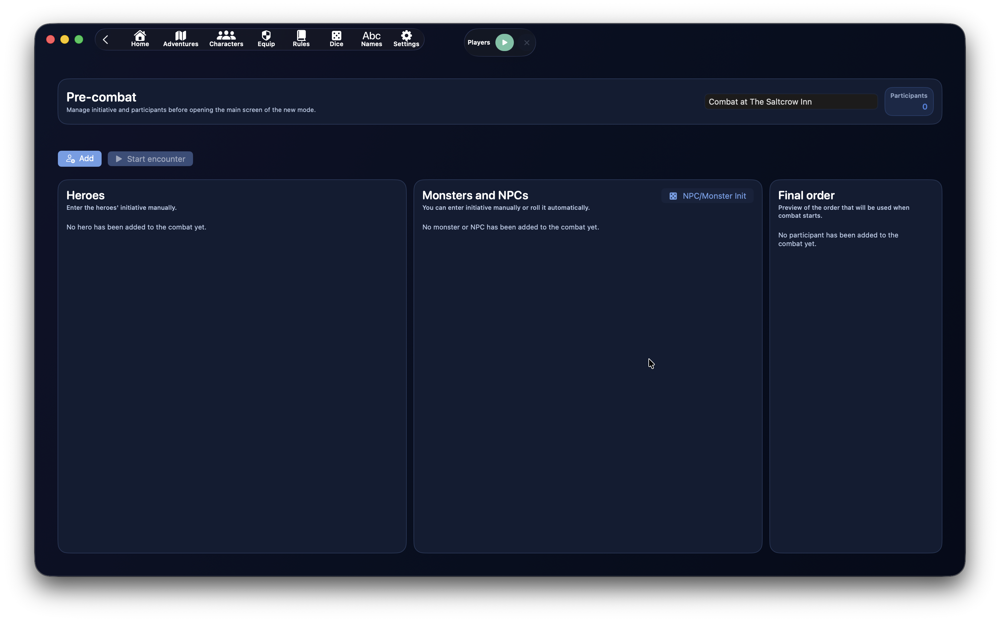{ .img-hero }

O pré-combate serve para preparar o encontro antes do primeiro turno.

O ecrã tem três áreas principais:

- **Heróis**
- **Monstros e NPCs**
- **Ordem final**

No topo vês também o nome do encontro, o número de participantes e as acções principais.

Os cartões dos participantes já usam a cor do papel nesta fase, para distinguir de imediato heróis, aliados, neutros e inimigos antes de iniciar o encontro.

## Acções do Pré-Combate

As acções principais são:

- `Adicionar`
- `Iniciar encontro`
- `Init NPCs/Monstros`, na coluna de monstros e NPCs

`Adicionar` abre o selector de participantes.

`Iniciar encontro` começa o combate. Se pelo menos um participante tiver iniciativa `0`, DnDino pede confirmação.

`Init NPCs/Monstros` lança automaticamente a iniciativa apenas para monstros e NPCs. Os heróis são normalmente introduzidos manualmente, porque o valor costuma vir da mesa.

## Modificar Nomes e Iniciativa

No pré-combate podes corrigir:

- nome apresentado do participante
- iniciativa

Isto é especialmente útil para monstros, por exemplo:

- Goblin 1
- Goblin 2
- Capitão goblin

A iniciativa é recebida enquanto escreves, sem ser necessário sair do campo. As colunas de trabalho não são reordenadas continuamente durante a escrita: a ordenação definitiva é aplicada ao iniciar o combate.

## Ordem Final

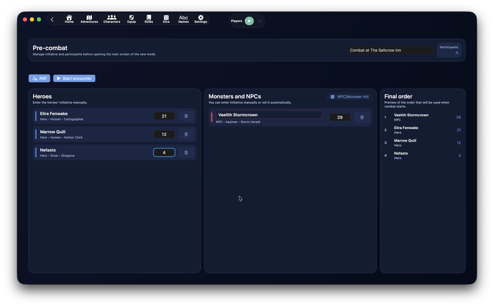{ .img-hero }

O painel **Ordem final** mostra a pré-visualização sempre actualizada da ordem que será usada ao iniciar.

A ordem é calculada assim:

1. iniciativa mais alta
2. em caso de empate, modificador de Destreza mais alto
3. se o empate continuar, desempate aleatório

Este painel permite controlar o resultado sem atrapalhar a introdução dos valores.

## Origem dos Participantes

O painel de adição pode propor:

- `Heróis`
- `Presenças do local`
- `Globais`

Heróis já ligados à aventura só podem entrar uma vez no mesmo combate.

As presenças do local reutilizam o estado local, se disponível.

Monstros globais podem ser adicionados várias vezes, porque muitas vezes representam várias cópias da mesma criatura.

## Combate Activo

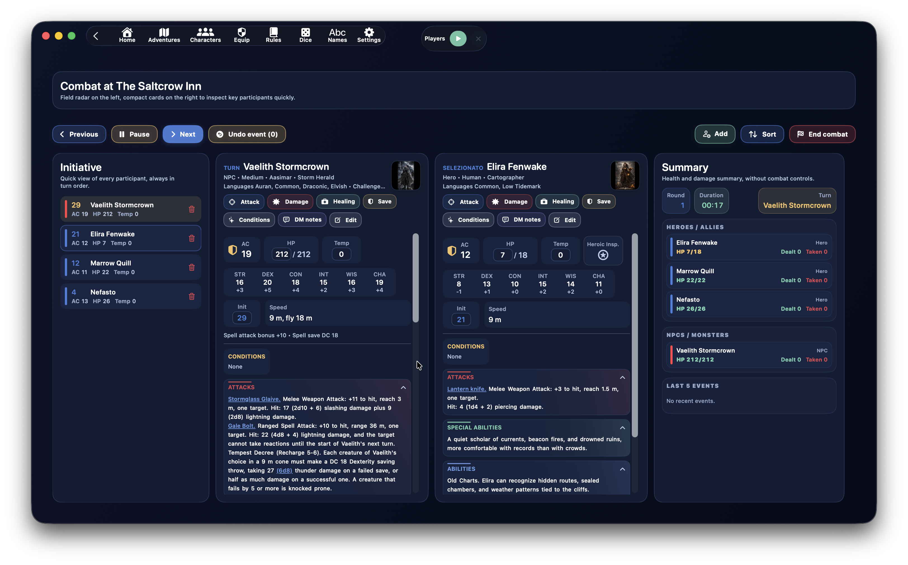{ .img-hero }

Quando o encontro começa, o ecrã passa para a gestão operacional.

Está dividido em três zonas:

- à esquerda, o **tracker de iniciativa**
- ao centro, as fichas compactas do **turno actual** e do **seleccionado**
- à direita, o **resumo** de saúde, dano e eventos

O objectivo é manter visível o máximo de informação útil sem abrir painéis enormes.

## Controlos do Turno

Os controlos principais estão no topo.

À esquerda:

- `Anterior`
- `Pausa` / `Retomar`
- `Seguinte`
- `Anular evento`

À direita:

- `Adicionar`
- `Ordenar`
- `Fim do combate`

`Anterior` e `Seguinte` mudam o turno.

`Pausa` pára o temporizador do combate. Em pausa, passa a `Retomar`.

`Anular evento` restaura um dos últimos eventos anuláveis.

`Adicionar` insere outros participantes mesmo durante o combate.

`Ordenar` reconstrói a ordem de iniciativa.

`Fim do combate` fecha o encontro após confirmação.

## Tracker de Iniciativa

A coluna esquerda mostra todos os participantes de forma compacta.

Cada linha mostra:

- iniciativa
- nome
- CA
- PV
- PV temporários
- indicador de condição, se existir
- cor do papel

A cor lateral ajuda a distinguir:

- heróis
- aliados
- neutros
- inimigos

Ao clicar numa linha:

- o participante abre como **seleccionado**
- se já estava seleccionado, a coluna do seleccionado fecha

O botão de lixo remove o participante do combate.

## Fichas do Turno e do Seleccionado

Ao centro podes ver até duas fichas:

- o participante do turno
- o participante seleccionado na lista

As fichas têm largura fixa e scroll vertical próprio, para a página se manter estável mesmo com textos longos.

No topo da ficha aparecem:

- nome
- tipo, linhagem ou subtipo
- idiomas, se existirem
- grau de desafio e XP, se existirem
- pré-visualização da imagem
- botões operacionais

## Campos Rápidos

Na ficha podes modificar directamente:

- PV actuais
- PV temporários
- iniciativa

A CA é mostrada como valor compacto com ícone de escudo.

Para heróis da aventura pode aparecer também o botão de **Inspiração Heroica**.

As alterações aos PV mantêm-se sincronizadas com a lista esquerda e o resumo direito.

## Acções do Participante

Cada ficha pode mostrar:

- `Atacar`
- `Dano`
- `Cura`
- `Salvaguarda`
- `Condições`
- `Notas do Mestre`
- `Modificar`

`Atacar` abre uma janela com o atacante e a lista de alvos.

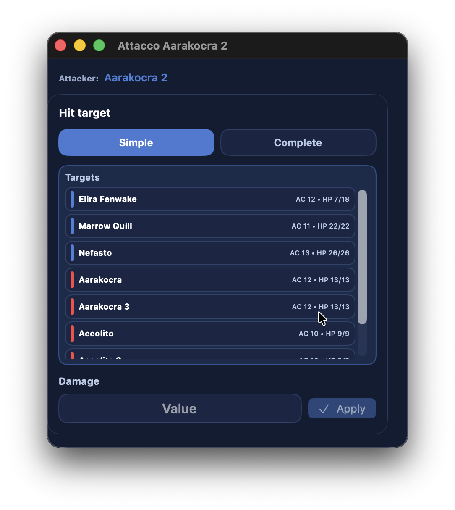{ .img-shot }

`Dano` aplica dano directo ao participante.

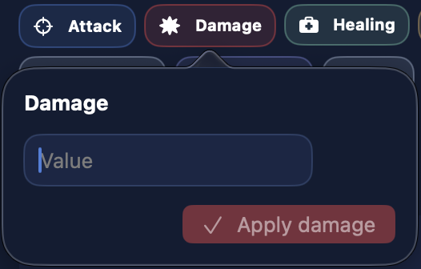{ .img-detail }

`Cura` aplica cura directa.

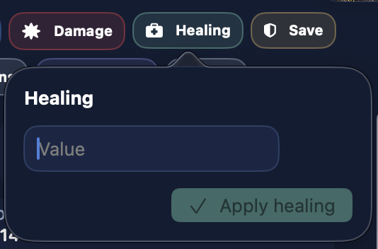{ .img-detail }

`Salvaguarda` abre as salvaguardas disponíveis.

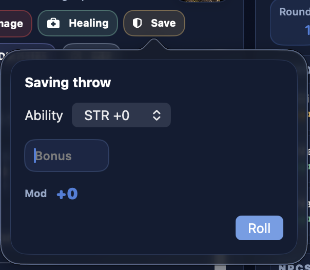{ .img-detail }

`Condições` abre uma janela dedicada à gestão de condições.

`Notas do Mestre` guarda apontamentos sobre o participante. As notas não entram na anulação.

`Modificar` abre o editor completo do participante.

## Lista de Alvos

As listas de alvos são ordenadas conforme o atacante.

Se o atacante for inimigo:

- primeiro heróis e aliados
- depois neutros
- depois inimigos

Se o atacante for herói, aliado ou neutro:

- primeiro inimigos
- depois neutros
- depois heróis e aliados

Dentro de cada grupo, os nomes são ordenados alfabeticamente.

A linha colorida lateral ajuda a reconhecer o papel do alvo.

## Ataques, Capacidades e Ligações Internas

As secções principais são:

- `Condições`
- `Ataques`
- `Capacidades especiais`
- `Capacidades`
- `Magias`
- `Descrição`

As secções são recolhíveis e usam um ligeiro gradiente coerente com a cor do título.

Os textos de ataques, capacidades especiais e capacidades podem conter ligações internas criadas durante a criação ou modificação da personagem.

Durante o combate, essas ligações abrem janelas dedicadas para resolver a acção com mais espaço.

As ligações mais úteis são:

- `Ataque completo`
- `1d20 + MOD`
- lançamento livre
- lançamento de dano
- ligações para entidades internas

## Ataque Completo

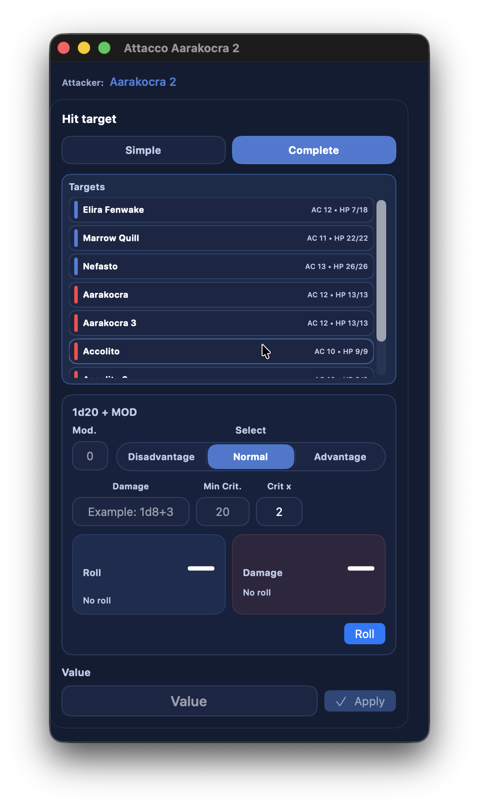{ .img-shot }
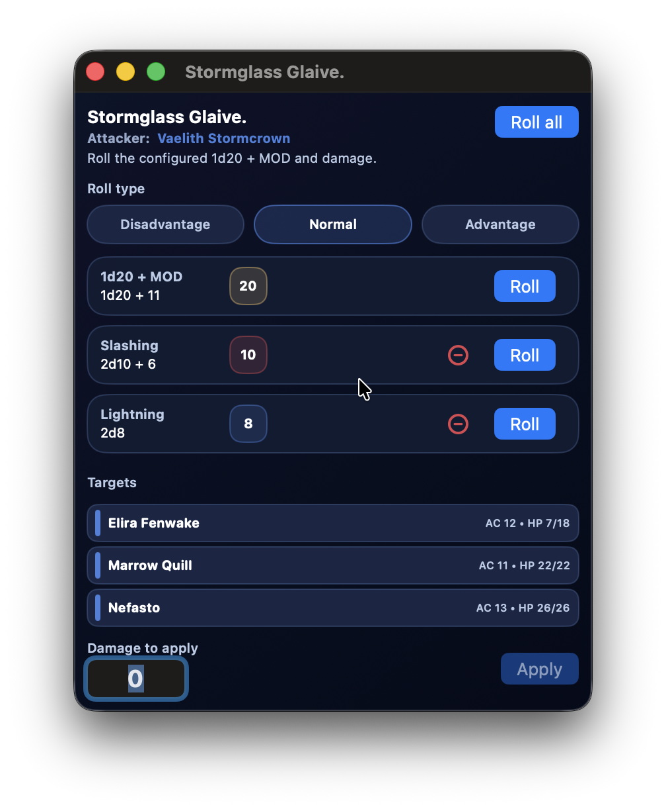{ .img-shot }

`Ataque completo` foi pensado para textos de ataque de monstros, NPCs ou heróis.

Prepara-se no ecrã de criação ou modificação da personagem: selecciona o texto do ataque e cria uma ligação do tipo `Ataque completo`. Durante o combate, esse texto torna-se uma acção pronta a abrir e resolver.

Quando usado em combate:

- a janela mostra o nome do ataque
- o atacante fica indicado claramente
- podes escolher um ou mais alvos
- se o ataque usar uma jogada de ataque, o DnDino pode indicar se o resultado atinge a CA dos alvos seleccionados
- podes gerir várias linhas de dano
- cada linha de dano pode ter um efeito textual opcional, útil para magias ou ataques com efeitos adicionais
- aplicas o dano seleccionado aos alvos escolhidos

Ao criar a ligação, podes escolher se se baseia em:

- `Jogada de ataque`
- `Teste de resistência`

No primeiro caso defines modificador, eventual intervalo de crítico e tipo de ataque. No segundo defines a CD do teste de resistência, a característica exigida e o tipo de ataque ou efeito.

Em ambos os casos, o dano é modular: o botão `+` adiciona linhas e só aparecem as linhas preenchidas. As fórmulas de dano também aceitam multiplicação e divisão sobre o total final, usando uma forma clara com parênteses, por exemplo `(1d8+3)/2`. A divisão arredonda para baixo: se o total for 11, `11/2` torna-se `5`.

## Magias

Se o participante tiver magias, a ficha mostra a secção `Magias`.

As magias são agrupadas por nível.

Para monstros e NPCs, a linha do nível também pode mostrar o contador de espaços usados, por exemplo:

- `0/3`
- `2/3`
- `3/3`

O botão `Usar` em cada magia aumenta o contador desse nível.

O contador não bloqueia a utilização quando chega ao máximo: serve apenas de lembrete para o Mestre.

Truques não usam espaços.

## Condições

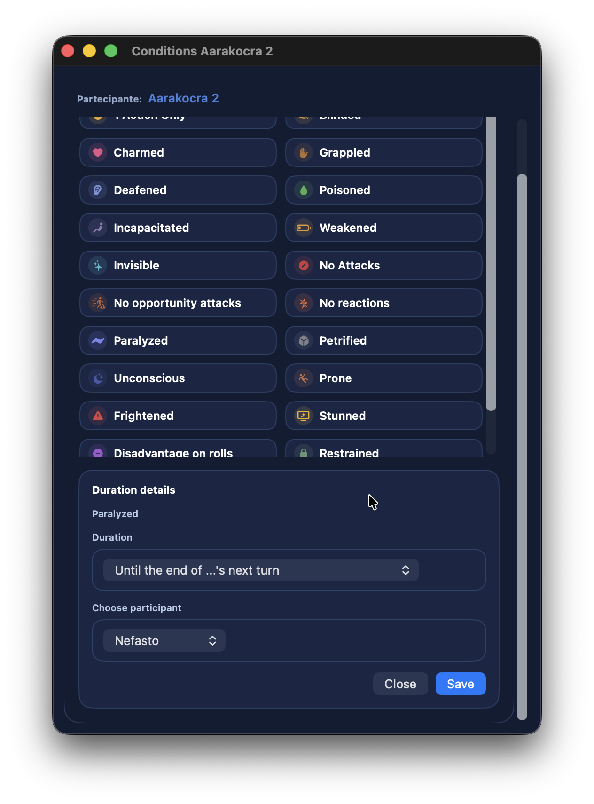{ .img-shot }

A janela `Condições` permite:

- adicionar condições
- remover condições
- escolher duração
- ligar a expiração ao turno de um participante
- gerir notas relacionadas

Quando uma condição é aplicada, DnDino mostra feedback visual no ecrã e na linha afectada.

## Heróis a 0 PV ou Menos

Os heróis seguem uma regra diferente de monstros e NPCs.

Um herói pode descer abaixo de `0` PV.

A regra é:

- entre `0` e `-(PV máximos - 1)` fica **Inconsciente**
- a `-PV máximos` ou menos morre
- também morre com 3 falhas nas salvaguardas contra a morte

Quando um herói está a `0` PV ou menos mas não morreu, a ficha mostra as **salvaguardas contra a morte**.

Com 3 sucessos, volta a `1` PV.

## NPCs e Monstros a 0 PV

Para NPCs e monstros a regra é mais simples:

- a `0` PV ou menos são considerados mortos
- são excluídos do ciclo de turnos
- o resumo pode mostrá-los como mortos

## Resumo Lateral

A coluna direita mostra o **Resumo**.

Inclui:

- round
- duração
- turno actual
- saúde de heróis e aliados
- saúde de NPCs e monstros
- dano causado
- dano sofrido
- últimos 5 eventos

É uma vista de controlo: serve para ler rapidamente a situação.

Os PV mudam de cor:

- normal se o participante está bem
- amarelo abaixo de 50 %
- laranja abaixo de 10 %
- vermelho a 0 ou menos

Para heróis, os PV só são riscados quando a personagem morreu mesmo, não apenas por estar abaixo de 0 PV.

## Últimos 5 Eventos e Anulação

O combate conserva os últimos eventos anuláveis.

A anulação pode incluir:

- ataques
- dano aplicado por ataques
- cura, se for gerida como evento anulável
- condições aplicadas ou modificadas

As `Notas do Mestre` não são anuladas.

A anulação também restaura as estatísticas ligadas, para que dano causado e sofrido continuem coerentes.

## Feedback Visual

Quando algo acontece no combate, DnDino mostra feedback imediato:

- banner superior
- animação na linha do participante afectado
- efeito no botão `Aplicar`, quando existir
- actualização do resumo lateral

Assim percebes logo que o comando foi recebido.

## Resumo Final do Encontro

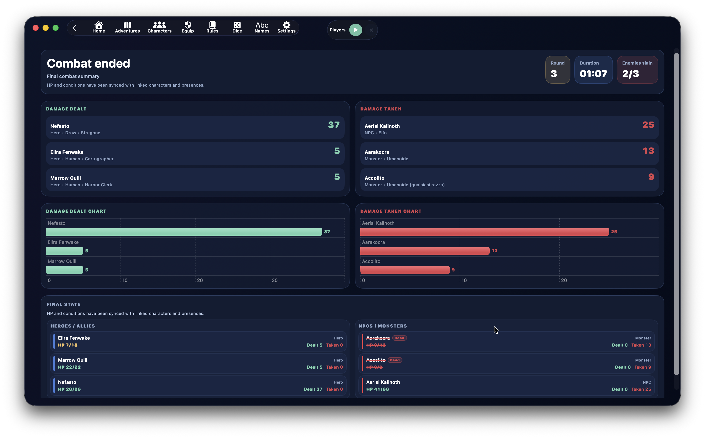{ .img-hero }

{ .img-shot }

Quando confirmas o fim do combate, o encontro deixa de ser modificável.

O ecrã final mostra:

- rounds totais
- duração
- inimigos mortos
- dano causado
- dano sofrido
- tempo médio dos turnos para heróis e Mestre
- estado final dos participantes

Os PV finais e as condições são sincronizados com os registos ligados.

## Sincronização Final

Ao fechar o combate, DnDino sincroniza os dados necessários.

Para heróis da aventura:

- PV actuais
- PV temporários
- condições
- estado final

Para presenças do local com estado local:

- PV actuais
- PV temporários
- condições
- estado final

O combate também pode alimentar dados da **sessão live** e estatísticas.

## Estatísticas

DnDino usa combates concluídos para alimentar estatísticas e gráficos.

As estatísticas podem incluir:

- dano causado
- dano sofrido
- duração dos encontros
- tempo médio dos turnos para heróis e Mestre
- número de combates
- inimigos mortos
- evolução do dano por sessão, com a data de início no eixo horizontal
- duração média das sessões

No painel da aventura, a vista **Estatísticas da Aventura** reúne combates concluídos, mesmo fora de uma única sessão live, e agrupa-os de forma consultável.

O resumo da sessão live pode mostrar gráficos dos combates concluídos durante essa sessão.

## Quando Funciona Melhor

O combate de DnDino funciona melhor quando:

1. preparas bem o pré-combate
2. atribuis iniciativas e nomes antes de começar
3. usas o tracker esquerdo para manter a visão geral
4. manténs aberta a ficha do turno e, quando útil, a do alvo seleccionado
5. usas ligações em ataques e capacidades
6. usas o resumo lateral para saúde, dano e eventos recentes
7. terminas o combate só quando tens a certeza, para manter estatísticas e sincronizações limpas

!!! tip
    Mesmo que DnDino automatize muitas operações, podes continuar a lançar dados físicos. Nesse caso, usa o combate sobretudo para aplicar dano, cura e condições rapidamente, sem recalcular PV e estatísticas à mão.
## Novidades da versão 1.4

As ligações de Ataque completo podem agora funcionar em dois modos:

- jogada de ataque
- teste de resistência

No modo jogada de ataque, DnDino pode comparar o resultado com a CA dos alvos selecionados e indicar se o ataque acerta. No modo teste de resistência, a janela foca-se na CD e na aplicação do dano.

A janela de Ataque completo também aceita um tipo de ataque, para indicar se é corpo a corpo, à distância, em área ou personalizado.

<!-- guide-coverage: MOD-025 MOD-026 MOD-028 MOD-029 MOD-030 MOD-039 MOD-044 MOD-055 MOD-058 MOD-059 MOD-063 MOD-069 MOD-081 MOD-082 MOD-083 MOD-088 -->

## Progressões, espaços e janelas de combate

O painel do PJ selecionado ou da vez tem **Recursos de classe** e **Espaços de magia**, recolhíveis separadamente. Cada progressão ocupa uma linha com nome, valor e descrição expansível: **Restantes/Total** com menos/mais para consumíveis, consulta para fixas. Recursos a zero ficam vermelhos. Os espaços mostram **Utilizados/Total**, separados por nível e origem; ficam vermelhos quando esgotados.

Os dados persistem sem ligação Hero. Em combates concluídos ficam apenas para consulta. Para personagens de Hero, a live controlada pelo Master permite alterar contadores compatíveis com confirmação da app do jogador; novas progressões ou máximos exigem a ficha completa. Consulta o [guia Hero](hero-sync.md).

Para **PNJ e monstros**, os **PV máximos** são editáveis ao lado dos atuais. Uma presença atualiza o seu valor local; um participante da ficha geral mantém a alteração apenas nesse combate. Reduzir o máximo limita PV superiores; aumentar não cura. Outras cópias e estatísticas não mudam.

No combate tático, **Condições** abre no ecrã da janela principal, mas pode ficar atrás dela. Recupera a janela pela barra inferior ou pela ação do mesmo participante, sem criar duplicados. Condições e **Ataque completo** não podem ser minimizados. Só pode haver um Ataque completo aberto; regressar mantém lançamentos, alvos e alterações. Usa a [barra inferior](topbar.md) para voltar ao combate em pausa.

### Participantes, alvos e iniciativa {#combat-participant-editor}

O editor tem um separador **Combate** para os valores do encontro e outros para a ficha base. O seletor de alvos mostra CA e PV em colunas distintas. Um PJ com 0 PV mantém-se na iniciativa se estiver inconsciente; os PJ mortos são ignorados.

## Estatísticas por sessão

O histórico de estatísticas da aventura agrupa combates por sessão. Abre o detalhe na mesma janela e usa o regresso às estatísticas. Combates e danos causados/recebidos são agregados por sessão com a **data de início no eixo horizontal**: sessões do mesmo dia ficam separadas, uma sessão que passa da meia-noite permanece unida. Combates sem sessão não recebem associações inventadas.
