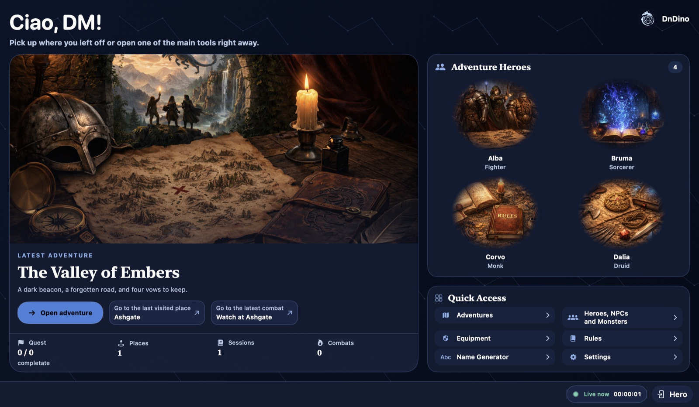
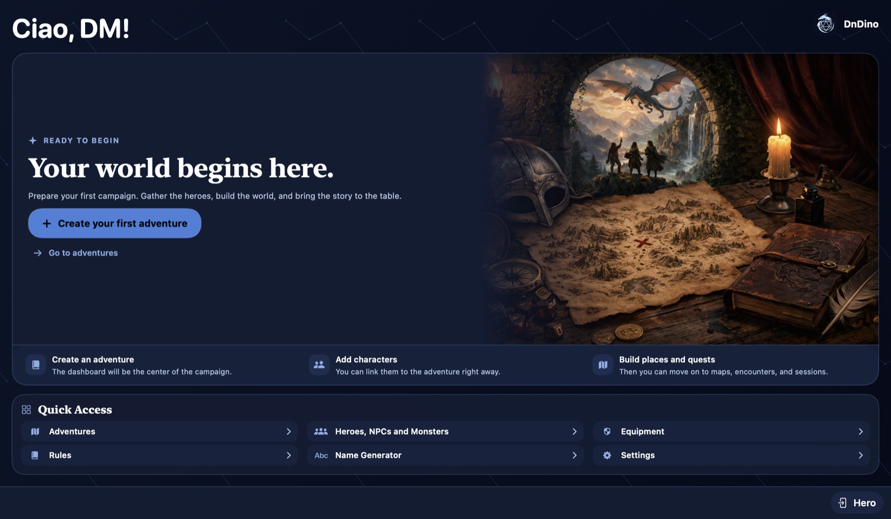

# Início: Mesa do Mestre

No DnDino 2.0.0, o ecrã inicial é a **Mesa do Mestre**. A saudação usa o nome do Mestre quando definido, e a disposição adapta-se à janela sem deslocamento.

{ .img-hero }

<!-- guide-coverage: MOD-144 -->

## Retomar uma campanha {#resume-adventure}

À esquerda aparece a última aventura aberta ou, se ainda não abriste nenhuma, a mais recentemente atualizada. A capa e os contadores resumem as missões concluídas, os locais sem contar missões, as sessões e os combates concluídos.

**Abrir aventura** leva ao painel da campanha. Os atalhos para o último local visitado e o último combate aparecem quando há dados disponíveis. [Painel da aventura](adventure.md).

## Heróis da aventura {#adventure-heroes}

Os heróis associados aparecem à direita. Até três retratos ficam lado a lado; quatro formam uma galeria 2 × 2; a partir de cinco, a grelha fica compacta. Acima de oito, um contador indica quantos não são mostrados. Sem imagem, aparece a inicial.

Os retratos grandes esbatem-se nos contornos. O enquadramento automático procura manter o rosto visível sem alterar o ficheiro original. Passa o ponteiro por um herói para ver PV e CA; clica para abrir a ficha da aventura em modo de leitura.

## Primeira aventura {#first-adventure}

Se a biblioteca estiver vazia, o botão para criar a primeira aventura abre diretamente o formulário. **Ir para aventuras** abre a biblioteca, onde também podes importar uma campanha. As boas-vindas ilustradas sugerem acrescentar personagens, locais e missões.

{ .img-shot }

## Acesso rápido {#quick-access}

Do ecrã inicial podes abrir **Aventuras**, **Heróis, PNJ e monstros**, **Equipamento**, **Regras**, **Gerador de nomes** e **Definições**.
